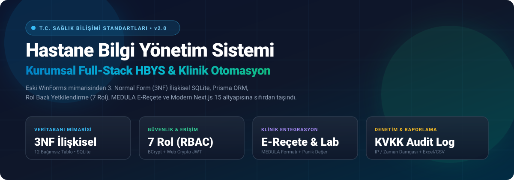
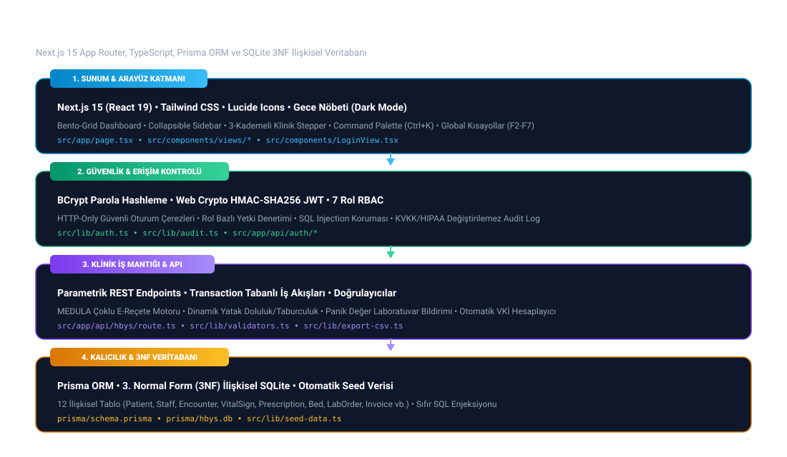
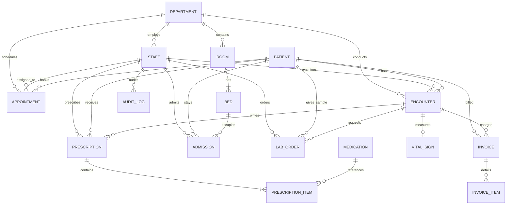
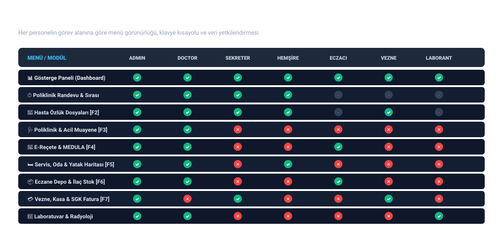

<div align="center">



# 🏥 Hastane Bilgi Yönetim Sistemi (HBYS v2.0)
### Kurumsal, Modern ve Rol Bazlı Full-Stack Hastane Otomasyon Platformu

[](https://nextjs.org/)
[](https://www.typescriptlang.org/)
[](https://www.prisma.io/)
[](https://www.sqlite.org/)
[](https://tailwindcss.com/)
[](#-güvenlik-ve-rol-bazlı-erişim-kontrolü-rbac)
[](#-lisans)

<p align="center">
  <b>T.C. Sağlık Bilişimi Standartlarına Uygun • Sıfır SQL Injection • 3NF İlişkisel Mimari • 7 Farklı Rol İzin Matrisi</b>
</p>

[Özellikler](#-temel-modüller-ve-yetenekler) • [Mimari](#-sistem-mimarisi) • [Yetki Matrisi (RBAC)](#-güvenlik-ve-rol-bazlı-erişim-kontrolü-rbac) • [Eski vs Yeni Karşılaştırması](#-eski-winforms-vs-yeni-hbys-v20-karşılaştırması) • [Demo Hesaplar](#-tek-tıkla-hazır-demo-kullanıcı-hesapları) • [Kurulum](#-kurulum-ve-çalıştırma)

</div>

---

## 📖 Proje Hakkında

Bu proje; klasik masaüstü Windows Forms (`.NET Framework 4.7.2` + `LocalDB .mdf`) mimarisinde geliştirilmiş eski bir **Hastane Bilgi Yönetim Sistemi (HBYS)** uygulamasının, tüm kritik güvenlik zaafiyetleri, ilişkisel veri tabanı eksiklikleri ve mimari hataları analiz edilerek **Full-Stack Next.js 15, TypeScript, Prisma ORM ve 3. Normal Form (3NF) SQLite Veritabanı** ile sıfırdan kurumsal düzeyde yeniden yazılmış modern web sürümüdür.

> 📁 *Tarihsel referans ve akademik karşılaştırma amacıyla ilk geliştirilen Windows Forms masaüstü projesi kaynak kodlarıyla birlikte [`legacy-winforms/`](./legacy-winforms) dizininde muhafaza edilmektedir.*

---

## 🏛️ Sistem Mimarisi

HBYS v2.0, yüksek güvenlik, taşınabilirlik ve atomik veri tutarlılığı sağlayan **4 katmanlı kurumsal mimari** üzerinde yükselmektedir:



### 📊 Veritabanı İlişki Diyagramı (ERD — 3NF Normalizasyonu)



---

## 🛡️ Güvenlik ve Rol Bazlı Erişim Kontrolü (RBAC)

Sistemde klinik gizlilik, tıbbi ayrım ve mali güvenlik ilkelerine tam uyumlu **7 kurumsal rol** tanımlanmıştır. Her personelin yetkisi dışında kalan menüler, klavye kısayolları ve API uç noktaları otomatik olarak filtrelenir ve engellenir:



### 📋 Detaylı Yetki ve Görev Alanı Tablosu

| Menü / Fonksiyon | Yetkili Roller | Kısayol | Görev ve Sorumluluk Sınırı |
| :--- | :--- | :---: | :--- |
| **Gösterge Paneli (Dashboard)** | *Tüm Roller* | - | Poliklinik yoğunluğu, acil triaj, doluluk ve anlık özetler |
| **Poliklinik Randevu & Sırası** | `ADMIN`, `DOCTOR`, `RECEPTIONIST`, `NURSE` | `G Q` | Randevu oluşturma, acil/öncelikli sıra çağrısı |
| **Hasta Özlük Dosyaları** | `ADMIN`, `DOCTOR`, `RECEPTIONIST`, `NURSE`, `CASHIER` | `F2` | TC Kimlik doğrulamalı kayıt, iletişim ve tam epikriz kartı |
| **Muayene & Vital Bulgular** | `ADMIN`, `DOCTOR` | `F3` | *Klinik Gizlilik:* Fiziki muayene, ICD-10 tanı, otomatik VKİ |
| **E-Reçete (MEDULA)** | `ADMIN`, `DOCTOR`, `PHARMACIST` | `F4` | Çoklu ilaçlı e-reçete yazımı, karekod ve resmi belge |
| **Servis, Oda & Yatak** | `ADMIN`, `DOCTOR`, `NURSE` | `F5` | Kat ve servis yatak doluluk haritası, yatış ve taburculuk |
| **Eczane & İlaç Depo Stok** | `ADMIN`, `PHARMACIST`, `DOCTOR` | `F6` | İlaç stok sayımı, miat takibi, reçete karşılama |
| **Vezne, Kasa & SGK Fatura** | `ADMIN`, `CASHIER`, `RECEPTIONIST` | `F7` | SGK katkı payı tahsili, POS kasa, makbuz ve fatura |
| **Laboratuvar & Radyoloji** | `ADMIN`, `DOCTOR`, `LAB_TECHNICIAN` | `G L` | Biyokimya/Radyoloji sonuç girişi, panik değer uyarısı |
| **Personel ve Hekim Yönetimi** | `ADMIN` *(Özel)* | - | Sağlık personeli sicil, branş, unvan ve rol atamaları |
| **KVKK / ISO 27001 Audit Log** | `ADMIN` *(Özel)* | `G A` | Değiştirilemez IP damgalı işlem ve güvenlik denetim izi |

---

## ⚡ Eski (WinForms) vs Yeni (HBYS v2.0) Karşılaştırması

| İnceleme Alanı | Eski WinForms Uygulaması (`legacy-winforms`) | Yeni Nesil HBYS v2.0 |
| :--- | :--- | :--- |
| **Kimlik Doğrulama** | `' OR '1'='1` ile atlanabilen SQL enjeksiyon açığı ve veritabanında düz metin (`plain-text`) şifreler. | **BCrypt** şifreleme + **Web Crypto HMAC-SHA256 JWT** oturumu + **7 Seviyeli RBAC**. |
| **Kayıt Güncelleme (`UPDATE`)** | `UPDATE` sorgusu yerine eski kaydı `DELETE` edip yeni `INSERT` yapma (Her düzenlemede ID değişmesi ve ilişkisel veri kaybı). | Birincil anahtarları (`ID`) ve yabancı anahtar ilişkilerini koruyan **gerçek `UPDATE` ve atomik `$transaction`**. |
| **Veritabanı Mimarisi** | 31 sütunlu devasa tek tablo (`patientlist`), kimlik bilgileri ile her muayenenin aynı satırda ezilmesi. | **12 Bağımsız İlişkisel Tablo (3NF)**: Hasta, Hekim, Muayene, Vital, Reçete, Yatak, Fatura ve Lab tabloları. |
| **Veritabanı Taşınabilirliği** | Kod içine gömülü sabit dosya yolları (`C:\Users\anilh\...`) ve derlemede veri sıfırlanması. | Bağımsız **Local SQLite (`prisma/hbys.db`)** + otomatik kurulum ve örnek veri tohumlama (**Auto-Seeding**). |
| **Veri Doğrulama** | Tarih ve ölçümlerin serbest metin (`NChar`) saklanması; TC Kimlik kontrolünün bulunmaması. | **11 Haneli Algoritmik TC Kimlik Doğrulaması**, ondalıklı ateş ölçümü, otomatik **Vücut Kitle İndeksi (VKİ)**. |
| **E-Reçete Yönetimi** | Tek satırlık metin alanı; reçetede tek ilaç sınırı. | **1-N İlişkisel Çoklu İlaç Kalemleri**, Vademecum dozaj şablonları, ICD-10 tanı kataloğu ve **Resmi E-Reçete Çıktısı**. |
| **Yataklı Servis & Oda** | Dolu odaya mükerrer hasta atanabilmesi; yatak takibinin olmaması. | **Canlı Yatak Haritası**, oda/yatak bazlı mükerrerlik engeli ve atomik taburculuk mekanizması. |
| **Arayüz ve Kullanılabilirlik** | Eski gri pencereler, responsive olmayan sabit formlar, gece modu eksikliği. | **Modern Bento-Grid**, Daraltılabilir Menü, **Gece Nöbeti (Dark Mode)**, Hızlı Komut Paleti (`Ctrl+K`). |

---

## 🧩 Temel Modüller ve Yetenekler

### 1. 📊 Bento-Grid Gösterge Paneli
- Canlı poliklinik ve acil başvuru sayaçları, yatak doluluk oranı ve kritik tahlil uyarıları.
- Branş bazlı hasta yoğunluğu dağılım grafikleri.
- Tek tıkla hızlı eylem butonları (Yeni Muayene, E-Reçete, Hasta Kabul).

### 2. 🩺 Poliklinik & Acil Muayene + Vital Bulgular (F3)
- 3 Kademeli Klinik Muayene Sihirbazı (Vital Bulgular ➔ Fiziki Muayene ➔ Karar & Reçete).
- Acil servis triaj sınıflandırması (🟢 Yeşil, 🟡 Sarı, 🔴 Kırmızı, ⚫ Siyah Kod).
- Ondalıklı ateş ölçümü (`36.8°C`), tansiyon, nabız, boy/kilo ve canlı **Vücut Kitle İndeksi (VKİ)** hesaplama.
- Hızlı Klinik Şablonlar (🦠 ÜSYE, 💓 Hipertansiyon, 🥣 Gastroenterit, 🩺 Check-Up) ile tek tıkla protokol doldurma.

### 3. 💊 Çoklu İlaçlı E-Reçete (MEDULA Uyumlu) (F4)
- Tek reçeteye sınırsız ilaç kalemi ekleme (Kutu, Periyot, Doz ve Kullanım Şekli).
- Sağlık Bakanlığı onaylı Vademecum ilaç ve ICD-10 tanı sözlüğü.
- E-Reçete Numarası ve resmi antetli kaşe formatında yazdırılabilir **PDF/Yazdırma Belgesi**.

### 4. 🛏️ Yataklı Servis Haritası & Oda Yönetimi (F5)
- Odaların ve yatakların (`101-A`, `201-VIP`, `YB-01-A`) anlık durumunu gösteren renkli yatak matrisi.
- Dolu yatağa mükerrer hasta atanmasını engelleyen atomik veritabanı kilitleri.
- Tek tıkla taburcu etme ve yatağı bir sonraki hastaya otomatik hazır hale getirme.

### 5. 🔬 Tıbbi Laboratuvar & Radyoloji Tetkik Takibi
- Biyokimya, Hematoloji, Kardiyoloji ve Radyoloji istemleri.
- Referans aralığı dışındaki sonuçlarda hekimi uyaran **Kritik / Panik Değer** alarmı.
- Tıbbi laborant rolü ile sonuç girişi ve hekim onayı.

### 6. 💳 Vezne, Kasa & SGK Faturalandırma (F7)
- Poliklinik ve yataklı servis hizmetlerinin otomatik fiyatlandırılması.
- SGK Katkı Payı ve Hasta Katkı Payı ayrımı.
- Nakit, Kredi Kartı (POS) ve Havale tahsilat yöntemleri ile makbuz üretimi.

### 7. ⌨️ Hızlı Komut Paleti (`Ctrl + K`) & Kısayol Tuşları
- Klavye odaklı hızlı hekim deneyimi:
  - `Ctrl + K`: Spotlight tarzı arama ve anlık komut çalıştırma.
  - `Alt + T`: Gece Nöbeti (Dark Mode) aç/kapat.
  - `F2`: Hasta Özlük Kartları
  - `F3`: Muayene ve Epikriz
  - `F4`: E-Reçete
  - `F5`: Yataklı Servis
  - `F6`: Eczane Depo Stok
  - `F7`: Vezne ve Fatura
  - `Esc`: Açık modalları kapat.

### 8. 📥 Kurumsal Excel / CSV Raporlama
- Hasta listeleri, muayene vizitleri, e-reçeteler ve laboratuvar sonuçları Microsoft Excel ve Google E-Tablolar ile tam uyumlu **UTF-8 BOM** formatında tek tıkla dışa aktarılır.

---

## 🔑 Tek Tıkla Hazır Demo Kullanıcı Hesapları

Giriş ekranında şifre girmeden tek tıkla test edebileceğiniz 7 farklı hazır rol bulunmaktadır:

| Rol Tanımı | Kullanıcı Adı | Şifre | Görevli Personel | Departman & Yetki Alanı |
| :--- | :--- | :--- | :--- | :--- |
| **Sistem Yöneticisi (`ADMIN`)** | `admin` | `admin123` | Yönetici Anıl Yılmaz | Tüm modüller, personel atama ve audit log |
| **Kardiyoloji Hekimi (`DOCTOR`)** | `dr.mehmet` | `123456` | Prof. Dr. Mehmet Özdemir | Muayene, E-Reçete, Yatış Kararı ve Tahlil |
| **Hasta Kabul (`RECEPTIONIST`)** | `sekreter.murat` | `123456` | Kabul Uzm. Murat Koç | Randevu sırası, hasta kaydı ve vezne |
| **Başhemşire (`NURSE`)** | `hemsire.ayse` | `123456` | Başhemşire Ayşe Çelik | Triaj, vital bulgular ve yataklı servis |
| **Başeczacı (`PHARMACIST`)** | `eczaci.ece` | `123456` | Başeczacı Ece Dağdelen | Eczane stok, ilaç girişi ve reçete kontrolü |
| **Vezne Memuru (`CASHIER`)** | `vezne.sibel` | `123456` | Vezne Memuru Sibel Tekin | SGK katkı payı, POS kasa ve tahsilat |
| **Tıbbi Laborant (`LAB_TECHNICIAN`)** | `laborant.caner` | `123456` | Laborant Caner Eren | Tahlil sonuç girişi ve panik değer bildirimi |

---

## 🛠️ Kurulum ve Çalıştırma

Proje **gömülü SQLite (`prisma/hbys.db`)** kullandığından harici bir SQL sunucusu (MSSQL, MySQL, Postgres vb.) kurmanıza gerek yoktur. Tek komutla çalışmaya hazırdır:

### Gereksinimler
- **Node.js** v18.17 veya üzeri
- **npm** veya **pnpm**

### Adım Adım Kurulum

```bash
# 1. Depoyu klonlayın
git clone https://github.com/anilhacioglu/hbys.git
cd hbys

# 2. Bağımlılıkları yükleyin
npm install

# 3. Veritabanı şemasını oluşturun ve örnek hastane verilerini yükleyin
npm run db:setup

# 4. Geliştirme sunucusunu başlatın
npm run dev
```

Tarayıcınızdan **`http://localhost:3000`** adresine gidin. Giriş ekranındaki hazır demo butonlarından dilediğiniz rolü seçerek hemen sistemi deneyimleyebilirsiniz.

---

## 📁 Proje Dizin Yapısı

```text
hbys/
├── docs/
│   └── assets/                     # Mimari diyagramlar, SVG şemalar ve görseller
├── prisma/
│   ├── schema.prisma               # 12 Tablolu 3NF İlişkisel Veritabanı Şeması
│   └── seed.ts                     # Otomatik veri tohumlama betiği
├── src/
│   ├── app/
│   │   ├── api/
│   │   │   ├── auth/               # Giriş, çıkış, oturum kontrol API'leri
│   │   │   └── hbys/               # Parametrik REST CRUD uç noktaları (RBAC korumalı)
│   │   ├── layout.tsx              # Kök düzen ve tema sağlayıcısı
│   │   └── page.tsx                # Ana HBYS uygulama kabuğu ve dinamik navigasyon
│   ├── components/
│   │   ├── views/                  # Modüler ekran bileşenleri (Dashboard, Muayene, E-Reçete vb.)
│   │   ├── CommandPaletteModal.tsx # Ctrl+K Hızlı Komut Paleti
│   │   ├── LoginView.tsx           # 7 Rol destekli modern giriş ekranı
│   │   └── PrescriptionPrintModal  # MEDULA E-Reçete yazdırma şablonu
│   ├── lib/
│   │   ├── auth.ts                 # Web Crypto HMAC-SHA256 JWT oturum motoru
│   │   ├── audit.ts                # KVKK/HIPAA uyumlu denetim izi kaydedici
│   │   ├── export-csv.ts           # UTF-8 BOM destekli Excel dışa aktarma
│   │   ├── prisma.ts               # Prisma ORM istemci tekil örneği (singleton)
│   │   ├── seed-data.ts            # Örnek poliklinik, hekim, ilaç ve hasta verileri
│   │   └── validators.ts           # TC Kimlik No ve VKİ matematiksel doğrulayıcıları
│   └── types/
│       └── hbys.ts                 # Katı TypeScript veri modelleri ve UserRole tanımları
├── legacy-winforms/                # Arşivlenmiş eski C# Windows Forms projesi
├── package.json
├── tailwind.config.ts
└── tsconfig.json
```

---

## 📜 Lisans

Bu proje [MIT Lisansı](LICENSE) kapsamında açık kaynak olarak lisanslanmıştır. Tıbbi bilişim standartları, eğitim ve kurumsal referans amaçlı özgürce kullanılabilir.

---

<div align="center">
  <sub>Geliştirici: <b>Anıl Hacıoğlu</b> • T.C. Sağlık Bilişimi ve Yazılım Mimarisi Standartları ile Geliştirilmiştir</sub>
</div>
